

<a href="https://alimurtazacv.vercel.app/"></a>

 

&nbsp;&nbsp;

  

<h2 align="center">Developer identity</h2>

<table>
<tr>
<td width="56%" valign="middle">

**Hi, I’m Ali Murtaza.**

I’m a **Full-Stack Developer** focused on building modern, responsive and visually engaging digital experiences.

I enjoy turning ideas into polished digital products, with a strong focus on **design, usability, responsiveness and interaction**.

> Code, design, interaction and usability should work together.

</td>
<td width="44%" valign="middle">
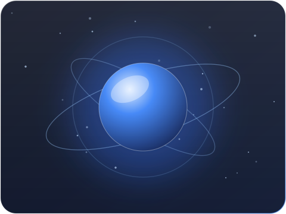
</td>
</tr>
</table>

| | |
| :-: | :-- |
|  | **Modern web development.** Next.js, React and TypeScript applications. |
|  | **Premium UI/UX.** Clear hierarchy, polished detail and glassmorphism-inspired interfaces. |
|  | **Interactive components.** Interfaces that respond and feel alive. |
|  | **Responsive experiences.** Layouts that adapt cleanly from phone to desktop. |
|  | **Modern application architecture.** Structured, maintainable projects. |
|  | **AI-powered web applications.** Practical AI features inside web products. |

<h2 align="center">What I build</h2>

<table>
<tr>
<td></td>
<td></td>
</tr>
<tr>
<td></td>
<td></td>
</tr>
<tr>
<td></td>
<td></td>
</tr>
</table>

<h2 align="center">Technology universe</h2>

HTML · CSS · JavaScript · TypeScript · React · Next.js · Tailwind CSS

  

Node.js · Python · Git · GitHub · npm

  

Figma

<h2 align="center">Creative development</h2>

  

<h2 align="center">Developer dashboard</h2>

Measured data, pulled live from GitHub through third-party stat services. If a card shows an error or stays blank, the service is temporarily unavailable or rate-limited; refresh later.

 

 

 

<h2 align="center">Contribution journey</h2>

<picture>
  <source media="(prefers-color-scheme: dark)" srcset="https://raw.githubusercontent.com/DotAliMurtaza/DotAliMurtaza/output/github-snake-dark.svg">
  <source media="(prefers-color-scheme: light)" srcset="https://raw.githubusercontent.com/DotAliMurtaza/DotAliMurtaza/output/github-snake.svg">
  
</picture>

Static contribution graph (fallback)

 

<h2 align="center">Featured projects</h2>

Real repositories from <a href="https://github.com/DotAliMurtaza?tab=repositories">github.com/DotAliMurtaza</a>. Each live link is the website set on that repository.

<h3 align="center">Interactive experiences</h3>

<table>
<tr>
<td align="center" valign="top">
<a href="https://github.com/DotAliMurtaza/car-game"></a> 

</td>
<td align="center" valign="top">
<a href="https://github.com/DotAliMurtaza/ludo-king"></a> 

</td>
</tr>
<tr>
<td align="center" valign="top">
<a href="https://github.com/DotAliMurtaza/tom-gold-run-"></a> 

</td>
<td align="center" valign="top">
<a href="https://github.com/DotAliMurtaza/upgrade-chess-game"></a> 

</td>
</tr>
</table>

<h3 align="center">E-commerce projects</h3>

<table>
<tr>
<td align="center" valign="top">
<a href="https://github.com/DotAliMurtaza/shoes"></a> 

</td>
<td align="center" valign="top">
<a href="https://github.com/DotAliMurtaza/uniq-glasses"></a> 

</td>
</tr>
</table>

<a href="https://github.com/DotAliMurtaza?tab=repositories">See all repositories on GitHub</a>

<h2 align="center">Design philosophy</h2>


<h2 align="center">Technology focus</h2>

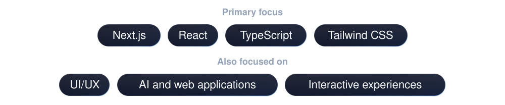
 
These describe where my attention goes, not measured skill levels.

<h2 align="center">Developer mindset</h2>

<table>
<tr>
<td>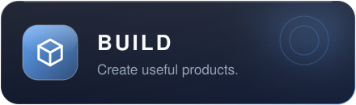</td>
<td>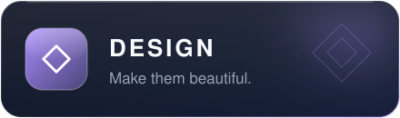</td>
</tr>
<tr>
<td></td>
<td>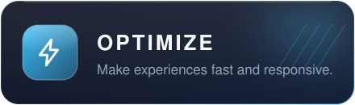</td>
</tr>
<tr>
<td colspan="2" align="center">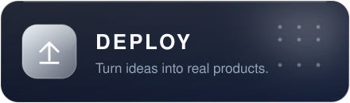</td>
</tr>
</table>

<h2 align="center">Portfolio</h2>

<a href="https://alimurtazacv.vercel.app/"></a>
  

<h2 align="center">Let’s connect</h2>

&nbsp;&nbsp;

 

